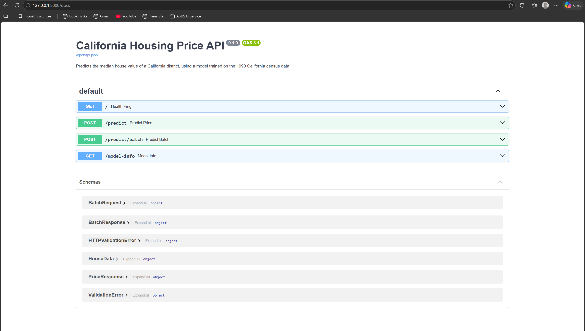
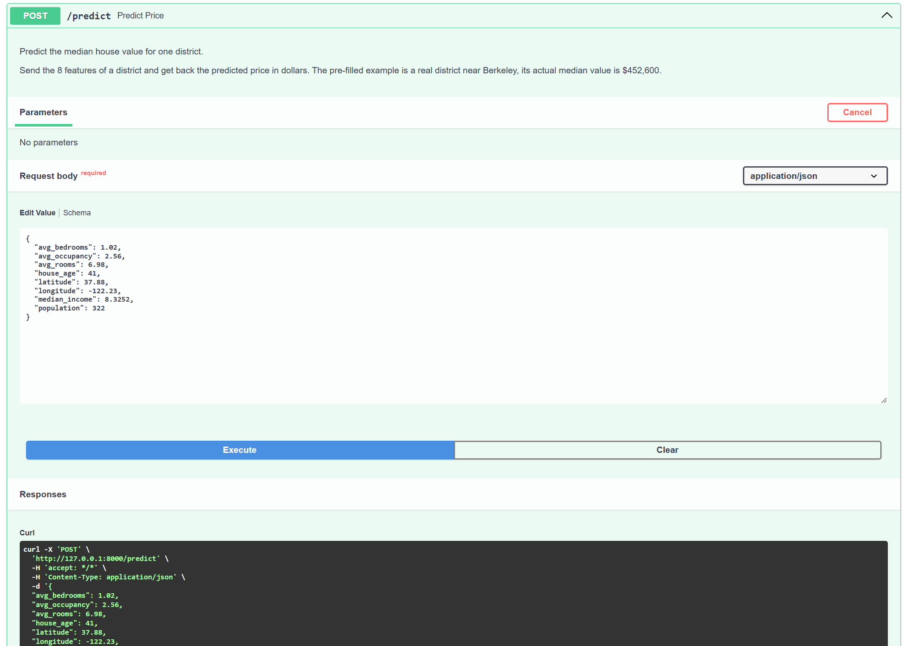
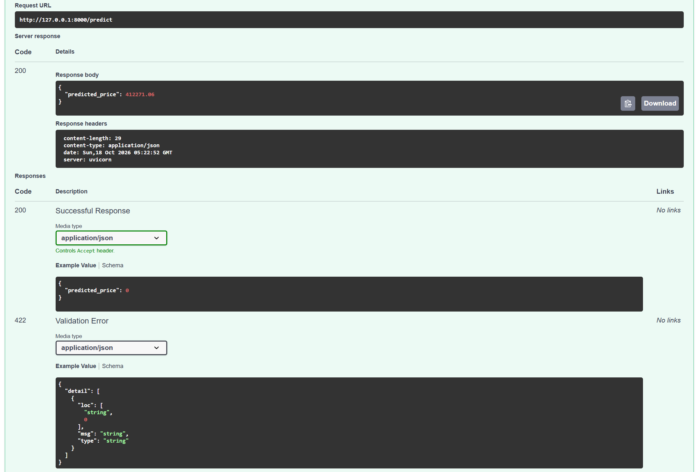
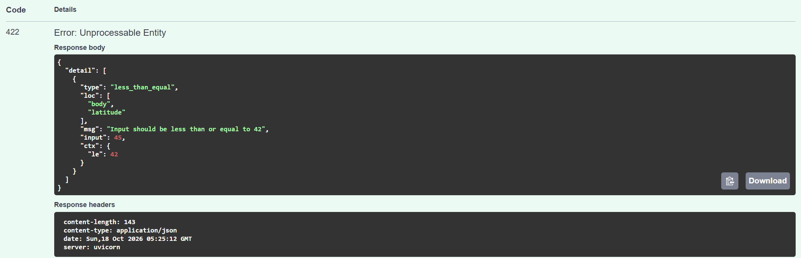

# FastAPI Lab: California Housing Price API

In this lab I built an API that predicts house prices using [FastAPI](https://fastapi.tiangolo.com/) and [uvicorn](https://www.uvicorn.org/). The original lab trained a Decision Tree on the Iris dataset and returned the flower class as a number (0, 1 or 2). I changed it to a regression problem using the California Housing dataset, so now the API takes information about a district and returns a predicted house price in dollars.

## What I changed

1. **Dataset:** Switched from Iris to the California Housing dataset (built into sklearn, from the 1990 California census). It has 20,640 districts and 8 features. The target is the median house value.
2. **Classification to regression:** The original lab predicted a class. Mine predicts a price, so I use RMSE and R² to evaluate instead of accuracy.
3. **Comparing models:** `train.py` trains two models, Linear Regression (as a baseline) and HistGradientBoostingRegressor, prints the scores for both on the test set, and saves the best one. The original lab never used its test set.
4. **Input validation:** Every field has rules using Pydantic `Field`:
   - income, rooms, bedrooms, population and occupancy have to be greater than 0
   - house age can't be negative
   - latitude has to be between 32 and 42 and longitude between -125 and -114, because the model only learned California
   - I also added a check that `avg_bedrooms` can't be bigger than `avg_rooms`

   If the input breaks a rule, FastAPI returns a 422 error with a message saying what's wrong, and the model never sees the bad data.
5. **Better response:** The API returns `{"predicted_price": 412271.06}` in dollars instead of `{"response": 0}`.
6. **New endpoints:** I added `/predict/batch` to predict up to 100 houses in one request, and `/model-info` to see which model is loaded and its test scores.
7. **Model loads once:** In the original `predict.py`, the model was loaded from disk on every single request. Now it loads one time when the server starts. It also gives a clear error ("Run train.py first") if the model file doesn't exist.
8. **Fixed paths:** The model path is now built from the file location, so the server works no matter which folder you start it from.
9. **Fixed the run command:** The original README said `uvicorn app:main`, but the correct command is `uvicorn main:app`.

## Project structure

```
FastAPI_Labs/
├── model/
│   ├── housing_model.pkl    # created by train.py
│   └── metrics.json         # test scores, created by train.py
├── src/
│   ├── __init__.py
│   ├── data.py              # loads and splits the dataset
│   ├── train.py             # trains, compares and saves the models
│   ├── predict.py           # loads the model and makes predictions
│   └── main.py              # the FastAPI app
├── README.md
└── requirements.txt
```

## Features

| Field | Meaning |
|---|---|
| `median_income` | Median income in $10,000s (8.3 means $83,000) |
| `house_age` | Median house age in years |
| `avg_rooms` | Average rooms per household |
| `avg_bedrooms` | Average bedrooms per household |
| `population` | Number of people in the district |
| `avg_occupancy` | Average people per household |
| `latitude` | Latitude (32 to 42) |
| `longitude` | Longitude (-125 to -114) |

## How to run

1. Create and activate a virtual environment, then install the requirements. I used Python 3.11 because `scikit-learn==1.5.1` doesn't support Python 3.13.
    ```
    python -m venv .venv
    .venv\Scripts\activate          # Windows
    source .venv/bin/activate       # Mac/Linux
    pip install -r requirements.txt
    ```
2. Go into the `src` folder and train the model. The first time it downloads the dataset, after that it's cached.
    ```
    cd src
    python train.py
    ```
3. Start the API:
    ```
    uvicorn main:app --reload
    ```
4. Open [http://127.0.0.1:8000/docs](http://127.0.0.1:8000/docs) to test the endpoints. The `/predict` endpoint already has an example filled in when you click "Try it out".



## Endpoints

| Method | Endpoint | What it does |
|---|---|---|
| GET | `/` | Health check, also shows which model is loaded |
| POST | `/predict` | Predicts the price for one district |
| POST | `/predict/batch` | Predicts prices for 1 to 100 districts |
| GET | `/model-info` | Shows the model type, features and test scores |

### Example request for `/predict`

This is a real district near Berkeley. Its actual median value is $452,600.



```json
{
  "median_income": 8.3252,
  "house_age": 41,
  "avg_rooms": 6.98,
  "avg_bedrooms": 1.02,
  "population": 322,
  "avg_occupancy": 2.56,
  "latitude": 37.88,
  "longitude": -122.23
}
```

Response:

```json
{
  "predicted_price": 412271.06
}
```



### Example request for `/predict/batch`

```json
{
  "houses": [
    { "median_income": 8.3252, "house_age": 41, "avg_rooms": 6.98, "avg_bedrooms": 1.02,
      "population": 322, "avg_occupancy": 2.56, "latitude": 37.88, "longitude": -122.23 },
    { "median_income": 2.0, "house_age": 20, "avg_rooms": 6.98, "avg_bedrooms": 1.02,
      "population": 322, "avg_occupancy": 2.56, "latitude": 34.05, "longitude": -118.24 }
  ]
}
```

Response:

```json
{
  "predictions": [412271.06, 252310.39]
}
```

### Validation examples

These are some bad inputs I tested and the errors the API gave back (all 422):

| Bad input | Error message |
|---|---|
| `latitude: 45` | Input should be less than or equal to 42 |
| `avg_bedrooms: 9` (more than rooms) | avg_bedrooms cannot be greater than avg_rooms |
| `median_income: -1` | Input should be greater than 0 |
| `population` left out | Field required |
| empty `houses` list | List should have at least 1 item after validation, not 0 |

This is what the error looks like in `/docs` when I sent `latitude: 45`. It says which field is wrong (`loc`), what the rule is (`le: 42`) and what I sent (`input: 45`):



## Results

| Model | RMSE | R² |
|---|---|---|
| Linear Regression | $72,901 | 0.6033 |
| **HistGradientBoosting** | **$46,041** | **0.8418** |

HistGradientBoosting was a lot better than Linear Regression, so that's the model the API uses. The saved model file is only about 380 KB.

## What I learned

- Changing from classification to regression changed more than just the model. I had to use different metrics (RMSE and R² instead of accuracy) and change the response from a class number to a price.
- Linear Regression did badly (R² 0.60) because house prices don't go up in a straight line with things like latitude and longitude. Location matters in a more complicated way, and the boosting model can learn that.
- I first thought about using Random Forest, but with default settings the saved file can be over 100 MB, which is too big for GitHub and slow for the API to load. HistGradientBoosting was more accurate and much smaller, so for an API it made more sense.
- Pydantic validation is really useful. I didn't have to write any if statements in the endpoints, I just put the rules on the fields and FastAPI rejects bad input by itself. It also shows the rules on the `/docs` page automatically.
- Loading the model once at startup instead of on every request is a simple change but it matters a lot if the API gets many requests.
- The field names in the API (`median_income`) are different from the dataset names (`MedInc`), so I had to make sure the features are passed to the model in the same order it was trained on. That's what `to_features()` in `main.py` does.
