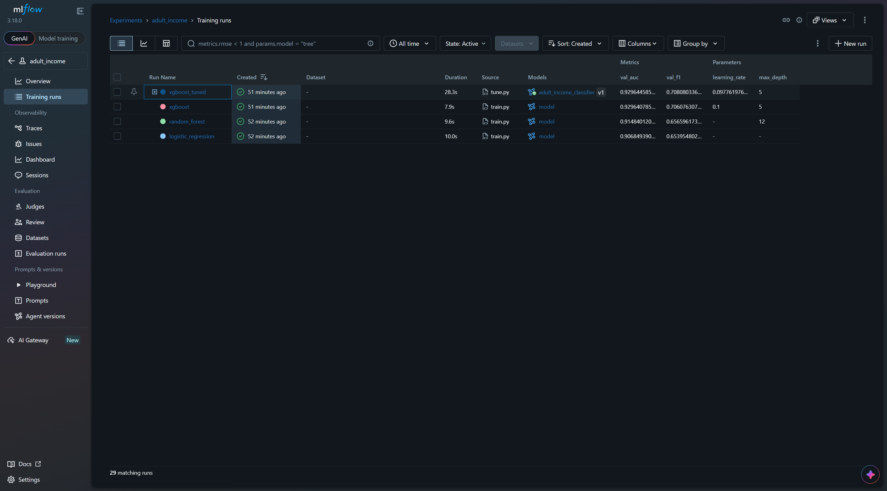
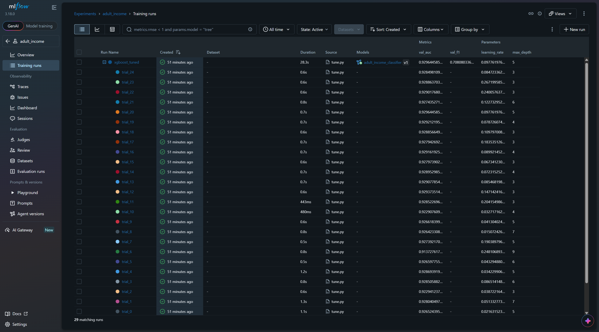
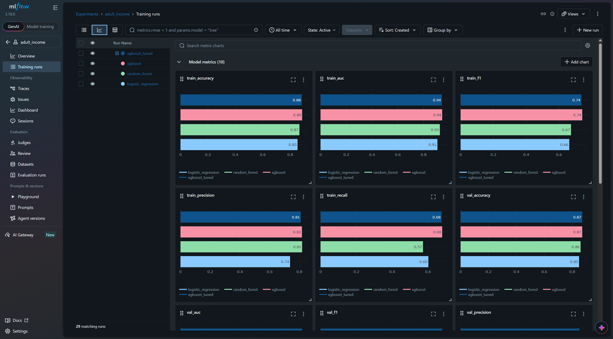
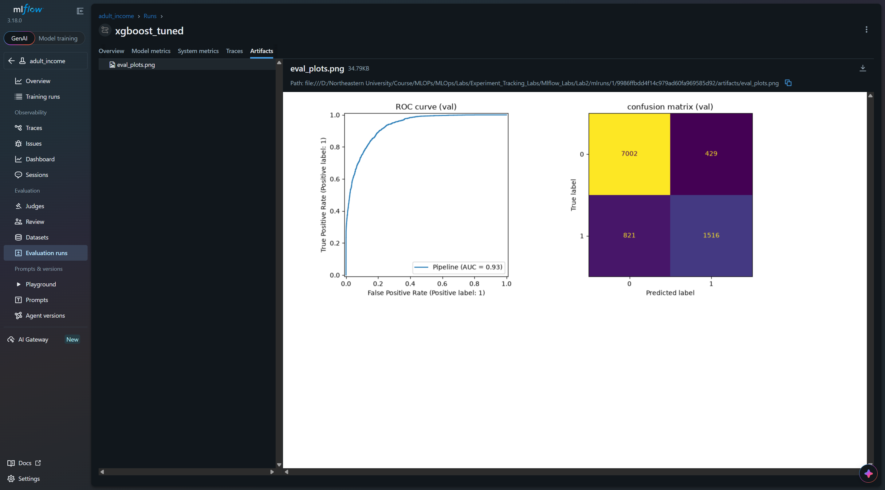
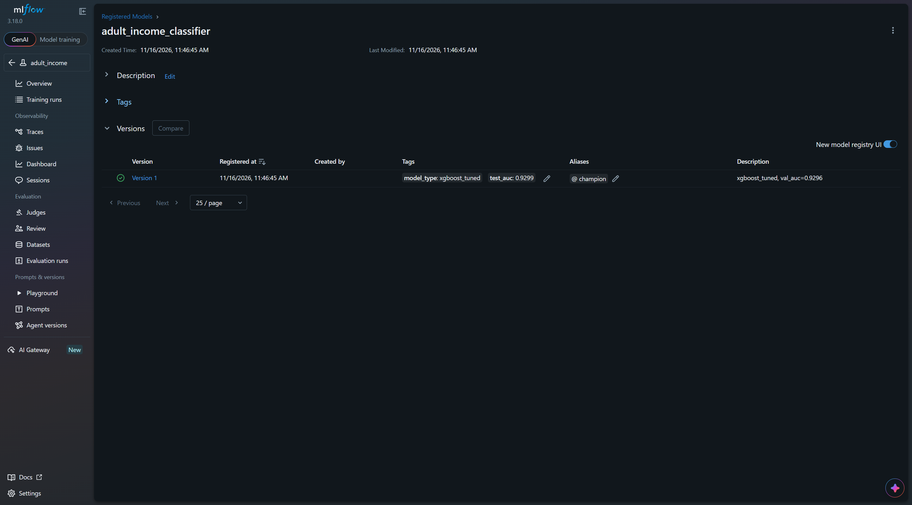

# MLflow Lab 2: Adult Income Prediction

The original lab used the Wine Quality dataset with a random forest, hyperopt and a Spark UDF for batch inference.
I changed it to predict if a person earns more than 50K a year using the UCI Adult Census Income dataset, and did tracking, tuning, the model registry and serving with MLflow.

## What I changed

- Used the Adult Census Income dataset (48,842 rows, about 24% earn >50K) instead of wine quality. It downloads from OpenML the first time and gets saved to `data/adult.csv`. I dropped `fnlwgt` (census weight) and `education` (same info as `education_num`), so 12 features are used.
- The preprocessing (impute, scale, one hot encode) is inside a sklearn `Pipeline`, so the logged model takes raw rows like `"occupation": "Sales"` and the served model doesn't need extra code.
- Compared 3 models: Logistic Regression, Random Forest and XGBoost. Each one is its own MLflow run with params, metrics on train and val (AUC, accuracy, precision, recall, F1) and a ROC curve + confusion matrix plot.
- Used Optuna instead of hyperopt to tune XGBoost (25 trials), each trial is a nested run under one parent run.
- The lab used `transition_model_version_stage(..., "Production")` which is deprecated now, so I used a model alias instead. `register.py` picks the best run by val AUC, registers it and sets the alias `champion`, then loads it with `models:/adult_income_classifier@champion`.
- Model selection only uses the validation set. The test set is only used once at the end on the champion.
- Batch inference with pandas instead of the Spark UDF (no Spark or Java needed). Predictions go to `outputs/test_predictions.csv`.
- Served the model with `mlflow models serve` and wrote a small script to send test rows to it.
- Used SQLite (`mlflow.db`) for the tracking backend since the model registry doesn't work with the plain file store.

## Files

| file | what it does |
|---|---|
| `data.py` | loads and cleans the data, splits 60/20/20, builds the preprocessing pipeline, mlflow settings |
| `train.py` | trains and logs the 3 baseline models |
| `tune.py` | optuna tuning for xgboost with nested runs |
| `register.py` | leaderboard, registers the best model, sets `champion` alias, tests it, saves batch predictions |
| `query_server.py` | sends a few rows to the served model |

## How to run

I used Python 3.11 on Windows.

```bash
python -m venv .venv
.venv\Scripts\activate
pip install -r requirements.txt

python train.py
python tune.py 25        # number of optuna trials
python register.py

# look at the runs
mlflow ui --backend-store-uri sqlite:///mlflow.db
# open http://127.0.0.1:5000
```

Serving the model (in a second terminal, with the venv activated):

```bash
set MLFLOW_TRACKING_URI=sqlite:///mlflow.db
mlflow models serve -m "models:/adult_income_classifier@champion" -p 5001 --env-manager local

python query_server.py
```

## Results

Validation set (9,768 rows):

| run | val AUC | val F1 |
|---|---|---|
| logistic_regression | 0.9068 | 0.6540 |
| random_forest | 0.9148 | 0.6566 |
| xgboost | 0.9296 | 0.7061 |
| xgboost_tuned (optuna, 25 trials) | 0.9296 | 0.7081 |

The tuned XGBoost was picked as the champion. On the test set (9,769 rows) it got AUC 0.930 and 87% accuracy.

| class | precision | recall | f1 |
|---|---|---|---|
| <=50K | 0.89 | 0.95 | 0.92 |
| >50K | 0.79 | 0.65 | 0.71 |

Output of `query_server.py` against the served model (7 out of 8 right, and the row with a missing occupation still works):

```
 age occupation         hours  actual predicted
  19 Craft-repair          56   <=50K     <=50K
  45 Adm-clerical          40   <=50K     <=50K
  30 Craft-repair          35   <=50K     <=50K
  44 Machine-op-inspct     35   <=50K     <=50K
  51 Transport-moving      40    >50K      >50K
  31 Craft-repair          75   <=50K      >50K
  78 missing               40   <=50K     <=50K
  42 Machine-op-inspct     40   <=50K     <=50K
```

## Screenshots

All runs in the MLflow UI (the tuned xgboost is the one linked to the registered model):



Optuna trials showing up as nested runs under `xgboost_tuned`:



Chart view comparing the metrics of the 4 models:



ROC curve and confusion matrix saved as an artifact for the champion run:



Model registry with the `champion` alias and the test AUC tag:



## What I learned

- Tuning barely helped here. The default XGBoost was already at 0.9296 val AUC and Optuna only got it to the same number with slightly better F1. Having all trials in MLflow made this easy to see instead of guessing.
- XGBoost was clearly better than logistic regression and random forest on this tabular data.
- Recall for >50K is only 0.65 even though AUC is high, because the classes are imbalanced and I used a 0.5 threshold. Lowering the threshold would catch more high earners but give more false positives.
- Putting the preprocessing in the pipeline made serving way easier, since the REST API takes the raw columns.
- Newer MLflow (3.x) saves sklearn models with skops instead of pickle for safety, so I had to pass `skops_trusted_types` for numpy, sklearn tree and xgboost types or `log_model` fails.
- Model stages are deprecated, aliases like `@champion` are the new way to point to the "production" version.
- On Windows, `mlflow models serve` needs the venv activated, otherwise it can't find `uvicorn`.
